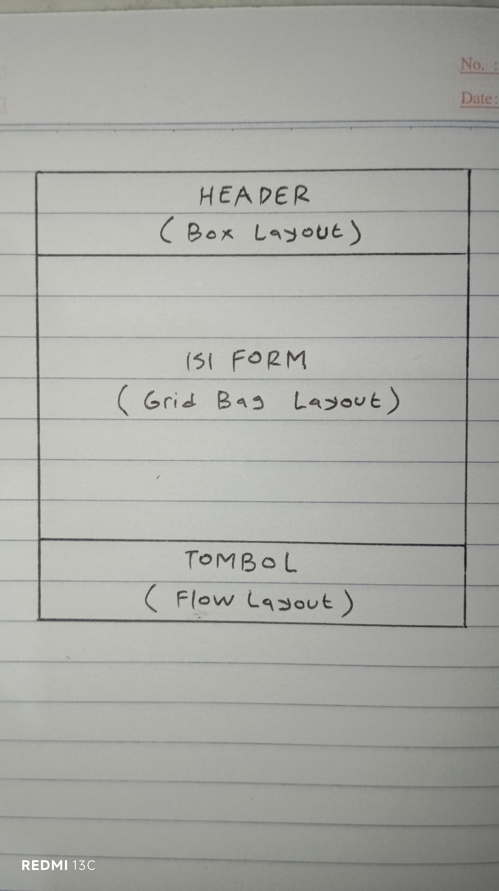
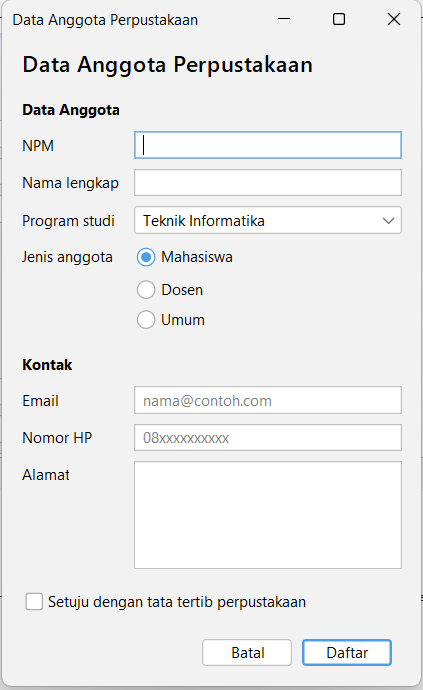
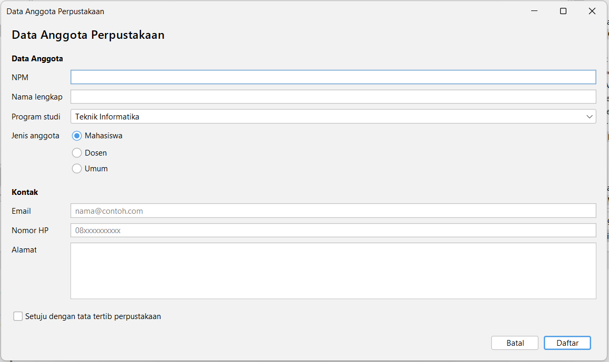
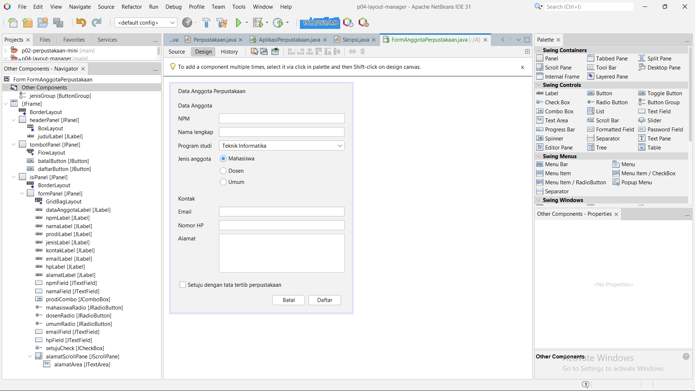

# P04 - Layout Manager dan Desain Form

Nama: Rahmat Ramadhan
NPM: 2410010285

## Tahap 1: Sketsa

## Tahap 2: Tabel Rancangan

| Bagian | Panel | Layout | Empty Border |
|---|---|---|---|
| Jendela | JFrame | Border Layout | Tidak ada |
| Header (North) | `headerPanel` [JPanel] | Box Layout, Y Axis | 16, 16, 8, 16 |
| Pembungkus (Center) | `isiPanel` [JPanel] | Border Layout | Tidak ada |
| Isi form (North di `isiPanel`) | `formPanel` [JPanel] | Grid Bag Layout | 8, 16, 8, 16 |
| Tombol (South) | `tombolPanel` [JPanel] | Flow Layout, Right, Gap 8 dan 0 | 8, 16, 16, 16 |

## Tangkapan Layar FormAnggotaPerpustakaan

### Ukuran awal

### Saat dilebarkan

### Tab Design dan Navigator

## Jawaban Eksperimen

### Eksperimen Praktikum 2
1. Saat Alignment diubah ke Center, tombol berderet di tengah, dan saat jendela
   dikecilkan tombol yang tidak muat pindah ke baris berikutnya dengan posisi rata
   tengah. Baris yang ikut berubah di initComponents() adalah
   flowPanel.setLayout(new java.awt.FlowLayout(java.awt.FlowLayout.LEFT, 8, 8));
   di mana LEFT berubah menjadi CENTER.

2. Terbentuk 5 baris. Karena Rows diisi 0, jumlah baris dihitung otomatis dari
   jumlah komponen dibagi jumlah kolom dan dibulatkan ke atas, yaitu 9 / 2 = 4,5
   menjadi 5 baris. Baris terakhir hanya berisi tombol 9.

3. Sebelum maximumSize diubah, tombol tetap berukuran asli saat jendela dilebarkan
   karena BoxLayout tidak membesarkan komponen melebihi ukuran maksimumnya. Setelah
   lebar maximumSize diisi 32767, tombol ikut melebar memenuhi lebar form. Vertical
   Strut menambah jarak vertikal antar tombol sesuai nilai tingginya; tinggi 0 tidak
   mengubah apa-apa, tinggi lebih besar membuat jarak makin lebar.

### Eksperimen Praktikum 4
1. Yang terjadi pada isian adalah tidak ada perbedaan yang terlihat.

2. Perbedaanya itu saat Direction masih di North, saat jendela ditinggikan semua 
   label dan isian akan ikut keatas. Sedangkan saat Direction dirubah menjadi 
   Center, waktu jendelanya ditarik semua label dan isian akan tetap berada di 
   tengah-tengah.

3. Bagian yang rusak lebih dulu adalah formPanel yang di dalamnya ada isiPanel, 
   lalu yang kedua ada headerPanel, lalu yang terakhir ada tombolPanel.

## Saran dari Teman (Tahap 4)
Dari M. Ridho Fadillah NPM 2410010166, saran dari dia untuk saya adalah
tambahkan placeholder pada isian NPM.

## Jawaban Pertanyaan Refleksi (Bagian G)
1. Null Layout dan Absolute Layout sebaiknya dihindari karena keduanya memakai
   posisi piksel yang tetap. Akibatnya, tampilan tidak menyesuaikan ukuran
   jendela, dan teks bisa terpotong kalau skala layar berbeda. Selain itu,
   Absolute Layout butuh library tambahan dari NetBeans, jadi aplikasinya
   sulit dijalankan di komputer lain.

2. Pada FlowLayout, komponen tetap berukuran asli dan berderet dari kiri ke
   kanan. Saat jendela dilebarkan, tombol tidak ikut membesar dan hanya
   menambah ruang kosong. Saat jendela dikecilkan, tombol yang tidak muat
   pindah ke baris berikutnya. Pada GridLayout, semua sel berukuran sama besar.
   Saat jendela dilebarkan, semua sel ikut melebar dan komponen di dalamnya
   ikut memanjang secara merata.

3. Weight X mengatur pembagian sisa lebar ke kolom-kolom saat jendela
   dilebarkan. Kolom dengan Weight X 1.0 menerima sisa lebar, sedangkan kolom
   dengan 0.0 tetap sempit. Fill mengatur apakah komponen memenuhi selnya.
   Dengan Fill Horizontal, isian ikut memanjang mengikuti lebar sel. Keduanya
   dipakai bersama: Weight X membuat kolom isian melebar, lalu Fill Horizontal
   membuat isiannya ikut mengisi kolom itu. Kalau salah satunya tidak ada,
   isian tidak akan melebar dengan rapi.

4. formPanel dibungkus isiPanel dan diletakkan di North supaya baris form
   tetap berada di atas saat jendela ditinggikan. Kalau formPanel langsung
   berada di Center, ia mengisi seluruh area tengah dan baris-barisnya jadi
   berpindah ke tengah dengan ruang kosong di atas dan bawah, seperti yang
   terlihat pada eksperimen Praktikum 4 nomor 2. Dengan isiPanel
   (BorderLayout) dan formPanel di North, formPanel hanya setinggi isinya dan
   sisa ruang kosong berada di bawahnya.

5. Dua prinsip yang saya terapkan pada Form Anggota Perpustakaan:
   - Keselarasan: label berada di kolom 0 dengan rata kiri (Anchor West) dan
     semua isian berada di kolom 1, sehingga label dan isian membentuk garis
     lurus dari NPM sampai Alamat. Buktinya terlihat pada tangkapan layar form
     saat dijalankan.
   - Kedekatan: isian yang berkaitan dikelompokkan dengan judul bagian. NPM,
     Nama lengkap, Program studi, dan Jenis anggota berada di bawah judul
     "Data Anggota", sedangkan Email, Nomor HP, dan Alamat berada di bawah
     judul "Kontak". Buktinya terlihat pada tangkapan layar yang sama.

## Deklarasi Penggunaan AI
Saya menggunakan Claude (Anthropic) untuk:
- memandu langkah pengerjaan Praktikum 3 dan Studio Desain (FormAnggotaPerpustakaan),
- memeriksa rancangan dan hasil form,
- merapikan redaksi jawaban eksperimen Praktikum 2 (pengamatan dilakukan sendiri;
  kalimat jawaban dirapikan dengan bantuan AI).
