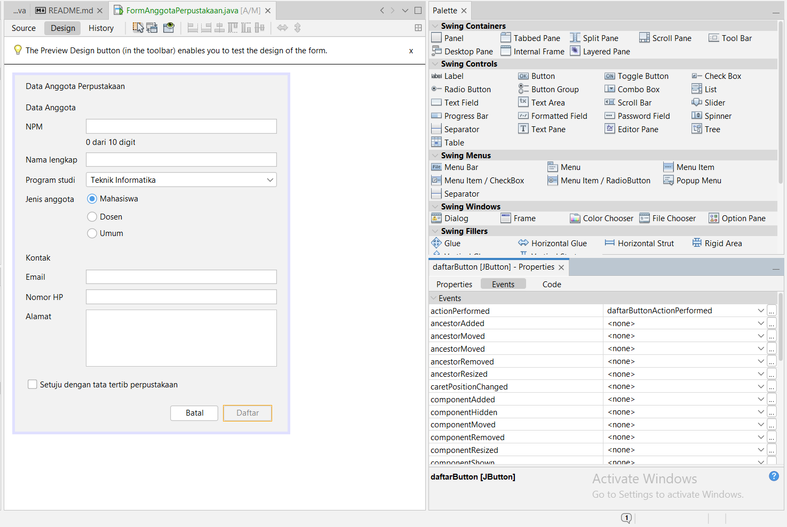
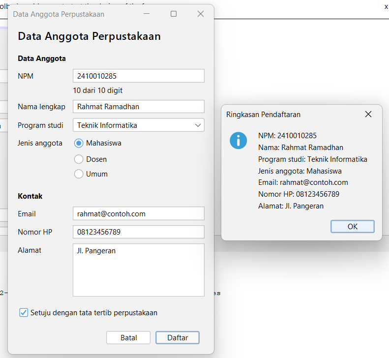
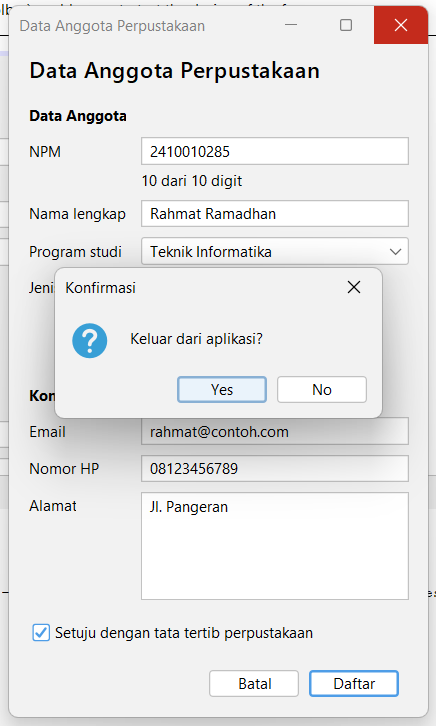

# P05 - Event Handling

Nama : Rahmat Ramadhan
NPM  : 2410010285

Proyek: `p05-event-handling` (package `id.ac.uniska.pbo2.p05`)

## Peta Event FormAnggotaPerpustakaan

| Komponen | Menu Events | Aksi |
|---|---|---|
| `setujuCheck` | Item: itemStateChanged | Tombol Daftar aktif hanya jika dicentang |
| `batalButton` | Action: actionPerformed | Kosongkan semua isian dan kembalikan fokus ke NPM |
| `daftarButton` | Action: actionPerformed | Tampilkan ringkasan data dengan JOptionPane |
| `npmField` | Key: keyReleased | Label kecil menampilkan jumlah digit, misalnya "8 dari 10 digit" |
| Form (JFrame) | Window: windowClosing | Minta konfirmasi sebelum aplikasi ditutup |

Pengaturan properti: `defaultCloseOperation` form = `DO_NOTHING`, dan `enabled` pada `daftarButton` tidak dicentang.

Logika yang dipakai oleh lebih dari satu tempat ditulis dalam method sendiri (`kosongkanForm()` dan `tampilkanRingkasan()`), sehingga event handler hanya memanggilnya.

## Tangkapan Layar

### Properties Events tombol Daftar

### Dialog ringkasan

### Dialog konfirmasi keluar

## Tabel Pengamatan Praktikum 2

| No | Tindakan | Event yang tercatat |
|---|---|---|
| 1 | Arahkan kursor ke tombol, lalu jauhkan | MouseEvent (kursor masuk ke tombol), MouseEvent (kursor keluar dari tombol) |
| 2 | Klik tombol Klik saya | MouseEvent (kursor masuk ke tombol), ActionEvent (tombol diklik) |
| 3 | Centang lalu hapus centang Aktifkan fitur | ItemEvent (kotak dicentang), ItemEvent (centang dihapus) |
| 4 | Ganti pilihan dari Pagi menjadi Malam | ItemEvent (memilih Malam) |
| 5 | Klik isian, lalu ketik kata "abc" | FocusEvent (isian mendapat fokus), KeyEvent (huruf a), KeyEvent (huruf b), KeyEvent (huruf c) |
| 6 | Klik tombol setelah mengetik di isian | FocusEvent (isian kehilangan fokus), MouseEvent (kursor masuk ke tombol), ActionEvent (tombol diklik) |

## Jawaban Eksperimen Praktikum 3

1. Pesan "item berubah" tercetak sebanyak 2 kali setiap pilihan diganti. Setelah pemeriksaan SELECTED dihapus, itemStateChanged tetap dipanggil untuk pilihan lama (DESELECTED) dan pilihan baru (SELECTED), jadi isi event handler berjalan dua kali. Karena itu pemeriksaan `evt.getStateChange() == ItemEvent.SELECTED` perlu ada supaya aksinya hanya berjalan sekali.

2. Hasil yang tampil terlambat satu karakter. Contohnya saat saya mengetik 3, hasil masih kosong, lalu saat mengetik 6 hasilnya baru menampilkan konversi untuk 3. Penyebabnya, keyPressed dipanggil saat tombol baru ditekan, sebelum karakternya masuk ke isian. Jadi saat `konversi()` membaca `getText()`, isian masih berisi teks sebelumnya. Pada keyReleased, tombol sudah dilepas dan karakternya sudah masuk, sehingga `getText()` berisi teks terbaru dan hasilnya langsung sesuai.

3. Setelah blok try dan catch dihapus, saat saya mengetik huruf pada isian, di jendela Output muncul pesan error NumberFormatException, misalnya `Exception in thread "AWT-EventQueue-0" java.lang.NumberFormatException: For input string: "a"`. Hal ini terjadi karena `Double.parseDouble` tidak bisa mengubah huruf menjadi angka. Tanpa catch, kesalahan itu tidak ditangani, sehingga hasilLabel tidak berubah dan tidak ada pesan "Masukkan angka yang valid" untuk pengguna. Jadi try dan catch dibutuhkan agar input yang salah ditangani dengan pesan yang jelas.

## Jawaban Eksperimen Praktikum 4

1. Pesan "kali" tercetak sebanyak 2 kali setiap tombol x diklik. Satu pesan berasal dari event handler buatan GUI Builder (`kaliButtonActionPerformed`), dan satu lagi dari lambda di konstruktor. Keduanya sama-sama terdaftar sebagai ActionListener pada kaliButton, jadi saat tombol diklik dua-duanya dijalankan. Karena itu satu tombol sebaiknya hanya memakai satu cara, supaya aksinya tidak berjalan dua kali.

2. Untuk menambahkan tombol %, di tab Design saya menambahkan satu Button baru di operatorPanel dengan teks %, memberi nama modulusButton, dan mengubah Columns pada Grid Layout operatorPanel dari 4 menjadi 5 supaya semua tombol muat satu baris. Di tab Source, saya membuat event actionPerformed untuk modulusButton melalui Events yang isinya `hitung('%');`, lalu menambahkan satu case baru di switch pada method hitung, yaitu `case '%' -> a % b;`. Pemeriksaan pembagian nol juga diperluas menjadi `operator == '/' || operator == '%'`.

3. Kursor langsung berada di isian pertama karena method hapus memanggil `angka1Field.requestFocusInWindow()` di baris terakhir. Method itu meminta fokus keyboard dipindahkan ke angka1Field, sehingga setelah semua isian dikosongkan pengguna bisa langsung mengetik angka pertama tanpa harus mengklik isiannya lebih dulu.

## Deklarasi Penggunaan AI

Saya menggunakan Claude (Anthropic) untuk:
- memandu langkah pengerjaan latihan mandiri FormAnggotaPerpustakaan (peta event, event handler, dan method bantu),
- merapikan jawaban eksperimen Praktikum 3 dan Praktikum 4,

Pengamatan pada aplikasi, pengujian, dan pengambilan tangkapan layar saya lakukan sendiri.
