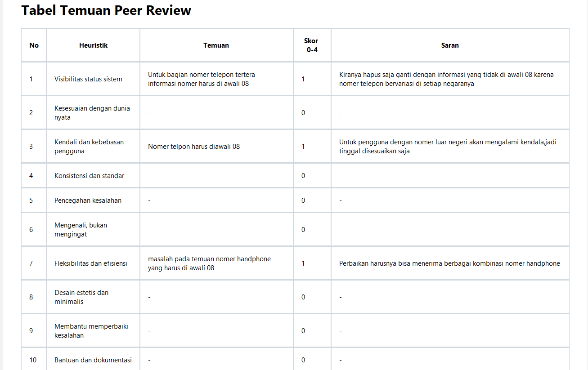
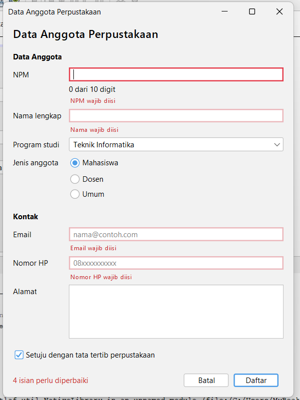
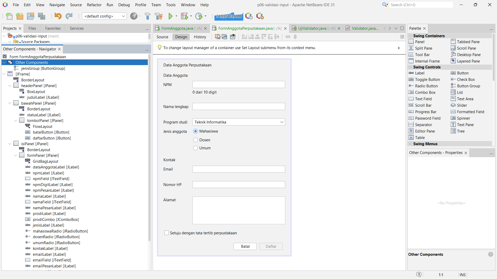

# P06 - Validasi Input dan Kegunaan
 
Nama : Rahmat Ramadhan
NPM  : 2410010285

Nama Peninjau: Azahari Faisal

Nama Pemilik Form: Rahmat Ramadhan

## Tangkapan Layar
 
### Form dengan pesan kesalahan

 
### Jendela Navigator yang memperlihatkan label pesan

 
## Jawaban Eksperimen Praktikum 4
 
1. Hurufnya nggak muncul sama sekali di isian NPM. Penyebabnya baris `if (!Character.isDigit(evt.getKeyChar()) || penuh) { evt.consume(); }` di `npmFieldKeyTyped`. Huruf bukan digit, jadi `!Character.isDigit(...)` bernilai true dan `evt.consume()` membatalkan karakternya sebelum masuk ke isian. Angka ke-11 juga ditolak lewat variabel `penuh`.
2. Pesan merah muncul pas saya pindah dari isian email dengan Tab, bukan waktu lagi mengetik. Itu karena pemeriksaannya ada di event `focusLost` (`emailFieldFocusLost`). Isiannya nggak kosong dan `Validator.email` menolak `siti@`, jadi muncul "Format email belum benar, contoh: nama@contoh.com" dengan garis merah.
3. Nggak ada pesan karena `namaFieldFocusLost` cuma memeriksa kalau `!namaField.getText().isBlank()`. Isiannya kosong, jadi `periksaNama()` nggak dipanggil. Ini disengaja: pengguna yang cuma lewat jangan langsung ditandai merah. Isian kosong baru diperiksa waktu Daftar diklik.
4. Fokus pindah ke isian NPM. Method `daftar()` memeriksa semua isian berurutan dan memasukkan yang salah ke daftar `salah`, lalu fokus dikirim ke `salah.get(0)`, yaitu yang pertama. Semua isian kena pesan: NPM, Nama, Email, dan Nomor HP "wajib diisi", ditambah Program studi "Pilih salah satu program studi", dan `statusLabel` menampilkan "5 isian perlu diperbaiki".
5. Fokus pindah ke isian Nama lengkap (`namaField`). Yang mengaturnya dua properti di `namaLabel`: `displayedMnemonic` bernilai N (huruf N pada label jadi bergaris bawah) dan `labelFor` bernilai `namaField` (menentukan isian mana yang mendapat fokus).
6. Datanya tetap ada. Di `batal()`, kalau `adaIsian()` bernilai true, muncul dialog konfirmasi. Kalau jawabannya bukan `YES_OPTION`, method langsung `return` sebelum `kosongkan()` dipanggil.
 
## Deklarasi Penggunaan AI
 
Saya menggunakan Claude (Anthropic) untuk:
- Membantu merapikan jawaban eksperimen Praktikum 4.

Tangkapan layar saya ambil sendiri.
 
